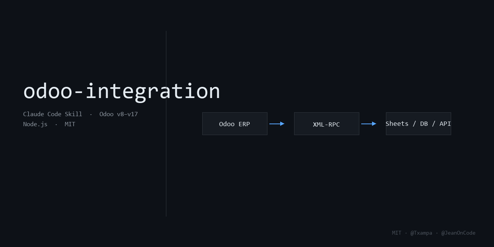

# odoo-integration



A [Claude Code](https://claude.ai/code) skill that gives Claude expert knowledge of Odoo integrations, over XML-RPC and the new JSON-2 API. Connect to any Odoo instance, query models, sync data to Google Sheets or other outputs, and deploy on Railway — without explaining the basics every time.

Works with **Odoo 8 through 19**.

---

## ⚠️ Odoo is retiring XML-RPC

Odoo 19 deprecated the XML-RPC and JSON-RPC endpoints (`/xmlrpc`, `/xmlrpc/2`, `/jsonrpc`). They are scheduled for
removal in **Odoo 22 (fall 2028)** and **Odoo Online 21.1 (winter 2027)**. The replacement is the
[External JSON-2 API](https://www.odoo.com/documentation/19.0/developer/reference/external_api.html): one
`POST /json/2/<model>/<method>` per call, an API key as bearer token, arguments by name.

The skill ships both clients with **the same methods**, so moving an integration to JSON-2 means swapping the client
and the credentials, not rewriting the sync:

```javascript
const OdooClient = require('./config/odoo');            // XML-RPC, Odoo 8–19
const OdooJson2Client = require('./config/odoo-json2'); // JSON-2, Odoo 19+, no dependencies

const odoo = new OdooJson2Client(); // ODOO_URL + ODOO_API_KEY
await odoo.authenticate();
const pickings = await odoo.searchRead('stock.picking', [['state', '=', 'assigned']], ['id', 'name', 'scheduled_date']);
```

Two things that catch people out: JSON-2 runs **every call in its own transaction**, and on Odoo Online the external
API (old and new) is only available on the **Custom** plan.

---

## How it works

Install the skill once. From that point, Claude understands the full integration stack without you having to explain it:

- XML-RPC and JSON-2 clients, authentication and API keys
- Which models to query and what their fields are called **in your version**
- How states differ between Odoo versions
- How to build reliable, incremental syncs with deduplication
- The traps of creating records over the API (onchanges that don't run, crons that do)
- How to deploy on Railway with proper secret management

Just describe what you need.

```
"Sync stock.picking records in state 'waiting' to Google Sheets every 15 minutes"
"Read all confirmed sale orders from Odoo 16 and export to CSV"
"Migrate this XML-RPC sync to the JSON-2 API, we're moving to Odoo 19"
"Debug why my sync stopped writing to the correct sheet tab"
"Add pagination — I have more than 100 pickings"
```

---

## Version compatibility

The XML-RPC protocol is the same from Odoo 8 to 19. What changes is field names, states and models. Checked against
the Odoo source of each branch, and the Odoo 19 rows against a running Odoo 19:

| What | Before | After | Since |
|------|--------|-------|-------|
| Picking lines | `move_lines` | `move_ids` | 16 |
| Picking scheduled date | `min_date` | `scheduled_date` | 11 |
| Detailed operations | `pack_operation_ids` | `move_line_ids` | 11 |
| Done quantity on a move | `quantity_done` | `quantity` | 17 |
| Stockable product | `type = 'product'` | `type = 'consu'` + `is_storable` | 18 |
| Invoices | `account.invoice` | `account.move` | 13 |
| Customer / supplier | booleans `customer`, `supplier` | `customer_rank`, `supplier_rank` | 13 |
| Locked sale order | state `done` | `sale` + `locked` | 17 |
| Locked purchase order | state `done` | `purchase` + `locked` | 19 |
| `stock.picking.date` | exists | removed (use `create_date`) | 19 |
| `stock.move.name` | exists | removed | 19 |
| `res.partner.mobile` | exists | removed | 19 |

Asking for a field that doesn't exist in that version makes the whole call fail, so the skill doesn't "fall back" by
requesting both names. It asks the server once:

```javascript
const fields = await odoo.fieldsGet('stock.picking');
const LINES = 'move_ids' in fields ? 'move_ids' : 'move_lines';
const DATE  = 'scheduled_date' in fields ? 'scheduled_date' : 'min_date';
```

---

## What's new in v2

- **JSON-2 client** for Odoo 19+, with the same interface as the XML-RPC one, and a migration path.
- **Tested against a running Odoo 19.0**: both clients, every field list in the skill, errors and API keys.
  That test caught two more fields removed in 19 (`stock.picking.date`, `stock.move.name`).
- **Version table corrected.** v1 said `move_ids` and `scheduled_date` arrived in Odoo 13: they arrived in 16 and 11.
  Added the changes in 17, 18 and 19.
- **`fieldsGet`** on both clients, to pick field names from the server instead of guessing.
- **Field lists per version** for pickings, moves, orders, products and partners.
- **Lessons from a production integration**: silent data loss with `limit` + `order`, `read` vs `search_read` with
  record rules, UTC datetimes, idempotent creates, incremental sync by `write_date`, onchanges and automated actions
  on API-created records, rounding, retries.

---

## What's inside the skill

The skill teaches Claude to generate this project structure from scratch:

```
odoo-sync/
├── config/odoo.js        OdooClient — XML-RPC wrapper (Odoo 8–19)
├── config/odoo-json2.js  OdooJson2Client — JSON-2 API (Odoo 19+), same methods
├── utils/sync.js         SyncManager — incremental sync with dedup
├── utils/sheets.js       SheetsClient — Google Sheets output
├── index.js              Cron scheduler
├── test-odoo.js          Verify raw Odoo connection
├── debug-states.js       Inspect model states in production
├── debug-move-lines.js   Inspect lines inside a specific picking
├── .env.example
└── Procfile              Railway: web: node index.js
```

Covered in depth: `stock.picking`, `stock.move`, `sale.order`, `purchase.order`, `product.product`, `res.partner` — with states, key fields, and domain filter patterns for each.

---

## Installation

```bash
git clone https://github.com/txampa/claude-skill-odoo-integration \
  ~/.claude/skills/odoo-integration
```

Claude Code discovers skills automatically from `~/.claude/skills/`. No configuration needed. The skill activates when you mention Odoo, XML-RPC, JSON-2, stock.picking, ERP sync, or Railway deployment.

---

## Requirements

- [Claude Code](https://claude.ai/code)
- An Odoo instance, 8 to 19 (self-hosted, Odoo.sh, or Odoo Online on the Custom plan)
- Node.js 18+ in your project
- A Google Cloud service account (only if syncing to Sheets)

---

## Credits

Created by [@Txampa](https://github.com/txampa).

Built from real production integrations with Odoo 8, extended with the field changes up to Odoo 19 and the JSON-2 API.

---

## License

MIT — free to use, modify, and distribute. See [LICENSE.txt](LICENSE.txt).
